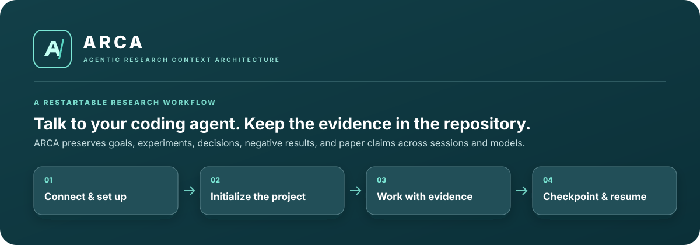

<div align="center">
  <a href="docs/ARCA_Quick_Start_User_Guide.pdf">
    
  </a>

  <p><strong>Research context that survives long projects, new sessions, and changing coding agents.</strong></p>

  <p>
    <a href="docs/ARCA_Quick_Start_User_Guide.pdf"><strong>Quick Start &amp; User Guide</strong></a>
    ·
    <a href="docs/GUIDELINES_v2.md">Operating guidelines</a>
    ·
    <a href="docs/CONTEXT_ARCHITECTURE.md">Architecture</a>
  </p>
</div>

## What is ARCA?

ARCA is a repository framework for machine-learning research carried out with coding agents such as Claude Code and Codex. It keeps the scientific objective, current state, experiments, decisions, negative results, and paper claims in versioned files with traceable provenance.

You work by talking to your agent. ARCA gives it a shared structure and focused workflows; the agent handles the files and helper scripts while you approve scientific decisions, costly runs, and commits.

> **The core idea:** Git-tracked ARCA records are the source of truth. Optional memory tools such as CortexDB help you find those records; they never replace the evidence.

## Start in a few minutes

The core workflow has no external service dependency. Put this template in a new project—or carefully merge its folders into an existing repository—then open the repository root with Claude Code or Codex.

### 1. Check the setup

Paste this prompt into your coding agent:

```text
SETUP CHECK — I am in a new ARCA project. Inspect the repository, the current
Git state, the ARCA template, and the available ARCA skills. Check that the
agent can discover the project instructions. Report missing or conflicting
files. Do not modify anything or run experiments yet.
```

### 2. Initialize the research project

```text
INITIALIZE ARCA — Read AGENTS.md, the applicable agent instructions, and the
ARCA template. Help me initialize this research project. Ask for the research
objective, questions, available datasets, evaluation metrics, compute
constraints, and target outputs. After I confirm the plan, populate
research/CHARTER.md, research/QUESTIONS.md, context/STATE.md, context/NEXT.md,
and the relevant registries. Do not invent findings. Do not start GPU jobs.
Run the ARCA structural check and show me the changes before proposing the
first Git commit.
```

You are ready when the objective and the next action are documented, the structural check passes (or its warnings are understood), and you have reviewed the initial changes.

### 3. Resume at any time

In a new session, after compaction, or when switching agents, invoke the included resume workflow:

| Agent | Command |
|---|---|
| Codex | `$arca-resume` |
| Claude Code | `/arca-resume` |

It reconstructs the current state from the repository, so it does not depend on the previous chat.

## The daily workflow

```text
Resume  →  Plan  →  Approve  →  Run & monitor  →  Review evidence  →  Checkpoint
```

| When | What to ask | What ARCA produces |
|---|---|---|
| Resume work | Invoke `arca-resume` | A read-only reconstruction of state and the exact next action |
| Start an experiment | “Create an ARCA experiment for [hypothesis]. Define controls, baseline, metrics, seeds, and a pilot. Register it, but wait for my approval before GPU use.” | An `E-####` record, protocol, config, and report skeleton; no training yet |
| Monitor a run | “Check the current job, GPU use, ETA, first results, and anomalies. Report issues early.” | A progress report without premature scientific conclusions |
| Audit evidence | Codex: `$research-evidence-audit` · Claude: `/research-evidence-audit` | A trace from claim to metrics, config, data, and artifacts, with gaps called out |
| Validate structure | “Run the ARCA structural check and summarize failures. Do not fix automatically.” | A portable consistency check of required files and selected references |
| End a substantial session | Codex: `$arca-checkpoint` · Claude: `/arca-checkpoint` | Updated state and next action, relevant notes, and a restartable checkpoint |

Small code or documentation tasks stay small: edit, test, and finish. Use the full experiment protocol only for substantive scientific work.

## How evidence stays connected

Every publishable quantitative claim should have a verifiable path back to the run that produced it:

```text
research question
      ↓
hypothesis  →  experiment E-####  →  finding F-###  →  paper claim
                  │                     │                 │
                  └─ config, data, metrics, artifacts, commit ─────────┘
```

ARCA keeps facts, source claims, hypotheses, interpretations, and decisions distinct. Negative and contradictory results remain visible so future sessions do not repeat failed work.

## What happens automatically?

| Capability | What it actually does |
|---|---|
| `arca-resume` | Guides the agent through the canonical state and relevant evidence. Invoke it explicitly for reliable resumption. |
| `new_experiment.py` | Allocates an experiment ID and creates starter files. The agent must complete the protocol and later record results. |
| `arca_check.py` | Checks repository structure and selected references—not scientific correctness or CortexDB connectivity. |
| `arca-checkpoint` | Guides state and notebook updates, then creates a checkpoint snapshot. |
| Hooks | Run only when installed and enabled for the current agent. Included examples are not automatic lifecycle management. |

ARCA never grants itself permission to launch expensive shared-GPU jobs, make major methodological changes, draw publication conclusions, or commit changes. Those decisions remain with you.

## Repository map

| Need | Canonical location |
|---|---|
| Research goal, scope, success criteria | [`research/CHARTER.md`](research/CHARTER.md) |
| Current state and next executable action | [`context/STATE.md`](context/STATE.md), [`context/NEXT.md`](context/NEXT.md) |
| Questions, hypotheses, findings, contradictions | [`research/`](research/) |
| Experiment registry, protocols, metrics, reports | [`experiments/`](experiments/) |
| Dataset fingerprints and artifact provenance | [`data/`](data/), [`artifacts/`](artifacts/) |
| Claims tied to evidence | [`paper/CLAIMS.md`](paper/CLAIMS.md) |
| Cross-agent instructions | [`AGENTS.md`](AGENTS.md) |
| Focused agent workflows | [`.agents/skills/`](.agents/skills/), [`.claude/skills/`](.claude/skills/) |
| Optional semantic memory | [`memory/CORTEXDB.md`](memory/CORTEXDB.md) |
| Complete operating guide | [`docs/GUIDELINES_v2.md`](docs/GUIDELINES_v2.md) |

The context is layered intentionally: agents read the small current state first, then retrieve only the evidence relevant to the task. See the [context architecture](docs/CONTEXT_ARCHITECTURE.md) for the full model.

## Prefer the terminal?

The agent can run these helpers for you, but they are also available directly and require only Python 3:

```bash
# Validate the ARCA structure
python3 scripts/arca_check.py

# Allocate a new experiment and its starter files
python3 scripts/new_experiment.py "initial baseline"

# Snapshot the current STATE and NEXT files
python3 scripts/session_checkpoint.py
```

`make check` and `make checkpoint` provide shortcuts for the first and third commands.

## Optional integrations

- **CortexDB** adds semantic recall and graph navigation. It is not required; follow [`memory/CORTEXDB.md`](memory/CORTEXDB.md) for isolation, permissions, privacy, and diagnostics.
- **Custom skills** package a genuinely repeated workflow. Keep them few and focused; see [`docs/SKILLS.md`](docs/SKILLS.md).
- **Feynman or other research agents** can support hypothesis generation, critique, and replication, but their output becomes evidence only after it is recorded and verified through ARCA.

## Common questions

<details>
<summary><strong>Do I need to edit every Markdown file myself?</strong></summary>

No. Start with the initialization prompt. The agent should fill only the relevant files and ask for missing scientific facts instead of inventing them.
</details>

<details>
<summary><strong>Does closing VS Code stop a training job?</strong></summary>

ARCA does not keep processes alive. A job continues only if it was launched through a persistent server-side process or scheduler; check the actual process or queue.
</details>

<details>
<summary><strong>Can Claude Code and Codex work on the same project?</strong></summary>

Yes. Give them separate tasks or worktrees and avoid simultaneous edits to the same files. For independent validation, let one agent review the other's result without treating that review as an experimental replication.
</details>

<details>
<summary><strong>What if the structural check passes but an experiment is wrong?</strong></summary>

That is possible. A structural check is not a scientific audit. Invoke `research-evidence-audit` and run the tests appropriate to the claim, including leakage and baseline-comparability checks.
</details>

<details>
<summary><strong>When should I checkpoint?</strong></summary>

Before ending a substantial session, switching agents or models, risking context compaction, or taking a long break—even if the current experiment is incomplete.
</details>

## Documentation

- **[Quick Start & User Guide](docs/ARCA_Quick_Start_User_Guide.pdf)** — illustrated, prompt-first walkthrough for the first setup and daily use.
- **[Operating guidelines](docs/GUIDELINES_v2.md)** — scientific discipline and the complete working protocol.
- **[Context architecture](docs/CONTEXT_ARCHITECTURE.md)** — how ARCA keeps retrieval focused.
- **[Agent compatibility](docs/AGENT_COMPATIBILITY.md)** — Codex, Claude Code, Feynman, and portability notes.
- **[Skills guide](docs/SKILLS.md)** — when and how to create focused workflows.

---

<div align="center">
  <strong>The agents do the work. You make the research decisions. The repository keeps the evidence.</strong>
</div>
